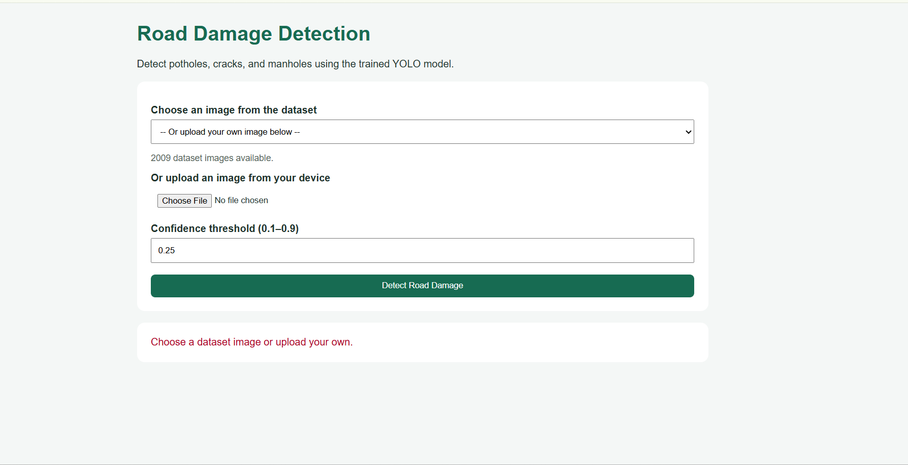

# Road-Damage-Detection-YOLO
Road damage detection using YOLOv8n, YOLO11n, and YOLO12n to detect potholes, cracks, and manholes, with model comparison, evaluation, and a Flask web application.

## Flask Web Application

The project includes a Flask web application for uploading road images and detecting potholes, cracks, and manholes.

